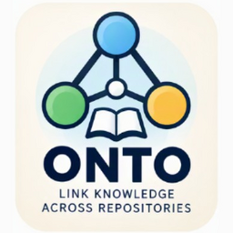
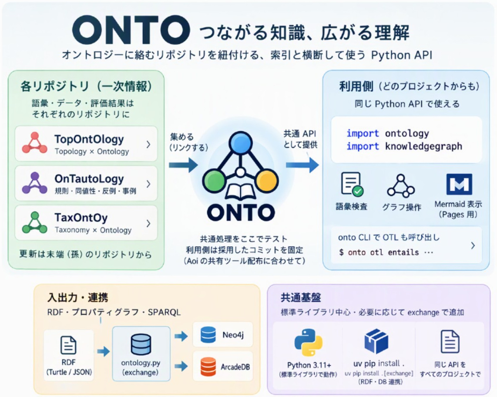
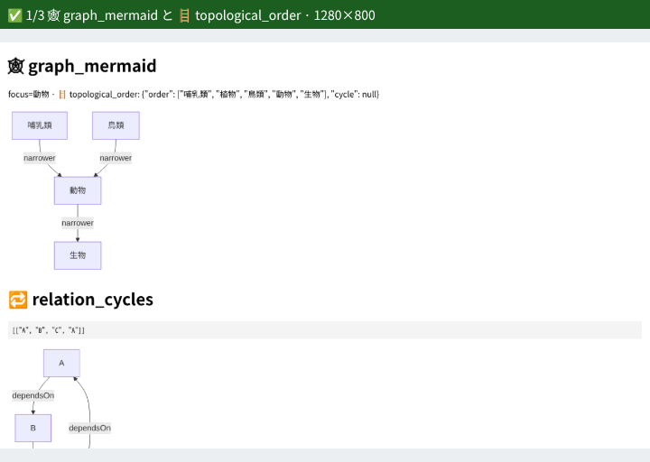

#  ONTO

オントロジーに絡むリポジトリを紐付ける、索引と、横断して使う Python API。

[](docs/assets/repository-concept.jpg)

[アイコン（256×256）](docs/assets/onto-icon.png) · [ ファビコン（32×32）](docs/assets/favicon.png)

## 役割

- 語彙・データ・評価結果の一次情報は各リポジトリ側に置く。語彙検査とグラフ操作の正本はリポジトリ直下の [ontology.py](ontology.py) と [knowledgegraph.py](knowledgegraph.py) に置く。
- 更新は末端（孫）のリポジトリから。ONTO はそれを集めてリンクする

## 紐付け先

- [TopOntoLogy](https://github.com/myon-bioinformatics/TopOntoLogy) — Topology × Ontology の造語プロジェクト
- [OnTautoLogy](https://github.com/myon-bioinformatics/OnTautoLogy) — 規則・同値性・反例・事例と判断の照合
- [TaxOntOy](https://github.com/myon-bioinformatics/TaxOntOy) — Taxonomy × Ontology

[Aoi の共有ツール配布](https://github.com/myon-bioinformatics/Aoi) に合わせ、共通処理はここでテストし、利用側は採用したコミットとファイルを固定します。
語彙やグラフ構造の変更は ONTO、論理的に成立する条件や反例の変更は OTL で扱います。

## パス解決の正本

[onto_path.py](onto_path.py) は checkout の根を決める正本です。標準ライブラリだけで動きます。ONTO 自身を解決するときは、このファイルがあるディレクトリを親より先に見るので、親に同じマーカーがあっても、このリポジトリの根になります。

子リポジトリは、このファイルを vendors した複製を持ちます。正本と複製で差し替えるのは先頭の定数だけで、`ROOTS` と `FLAGS` の形は同じです。関数の本体も共通ですが、正本には `dirname` が `"."` の自己解決の枝があります。その枝は子の dirname では挙動を変えません。子リポジトリはこれを追わなくてよく、それぞれのテストが自分の複製をカバーします。

## 共通 Python API

checkout を `uv pip install .` で導入すると、どのプロジェクトからも次の入口を使えます。

```python
import ontology
import knowledgegraph
```

[分類例](examples/shared_taxonomy.py) は同じグラフで語彙検査・循環検出・Mermaid 表示を行います。
共通処理を直すときは ONTO を更新し、利用側で採用する版を選びます。

Pages で Mermaid を描画するときは、ビルド時に `knowledgegraph.mermaid_renderer_js()` の戻り値を UTF-8 のモジュールとして一度書き出す。各画面はそのモジュールから `renderDiagram(id, source)` を import する。最初の描画時に固定版の Mermaid を CDN から読み込み、同じページの以後の描画でも使う。

## RDF・プロパティグラフの入出力

[ontology.py](ontology.py) は RDF の読み込み、SPARQL 照会、Neo4j・ArcadeDB への入出力を担当します。
`uv pip install '.[exchange]'` で追加できます。保存済み RDF の照会は DB を起動せずに実行できます。

```sh
python -m ontology query graph.ttl 'SELECT ?s ?p ?o WHERE { ?s ?p ?o }' > answer.json
python -m ontology export neo4j demo > graph.ttl
python -m ontology export neo4j demo --format json > graph.json
```

OTL はこの実装に事例・判断を渡し、論理検証で使ったデータが DB 往復後も同じかを調べます。

### `onto` CLI

The `onto-shared` distribution installs `onto`. Help, version inspection,
and the shared Python modules need no RDF dependencies.

- `onto exchange export neo4j trial graph.json` writes JSON to a file.
  Use `graph.ttl` for a Turtle file, or omit the filename for Turtle on stdout.
  `onto exchange export neo4j trial --format json` sends JSON to stdout.
  Exchange commands use the `onto-shared[exchange]` extra.
- `onto otl …` forwards arguments and standard streams to the separately
  packaged OnTautoLogy CLI using uv. The child's `exchange` route and `entails --ttl` request
  its RDF dependencies. Set `UV_OFFLINE=1` to use only an existing uv cache.
- `onto versions --json` reports the pinned OnTautoLogy source. This launcher
  does not yet package or dispatch TOO or TOL.

### 分類規則を反例で点検する

`onto otl entails` は、明示した命題論理の前提をすべて満たし、結論だけを偽にできるかを調べます。
たとえば「猫なら哺乳類」を登録しても「哺乳類なら猫」とは限りません。

```sh
echo '{"premises":[["OR",["NOT","猫"],"哺乳類"],"哺乳類"],"conclusion":"猫"}' | onto otl entails -
```

この例では `counterexample` が返り、「哺乳類が真、猫が偽」が反例になります。
整合する前提から結論が従う場合は `entailed`、前提自体が矛盾する場合は
`inconsistent-premises` です。結果をTurtleで保存するには `--ttl -o result.ttl` を付けます。

## GitHub Pages

[ONTO の利用ガイド](https://myon-bioinformatics.github.io/ONTO/)（🎞 GIF デモ / 🧩 機能一覧）は、データだけの `docs/guide.page.json` を親の `reusable-pages-static.yml` が固定版の PySaiyanWeBoo で描きます。



GIF は BrowserTestKit の `evidence_gif.py` で撮りました（受領票 [`docs/assets/graphs.json`](docs/assets/graphs.json)）。
