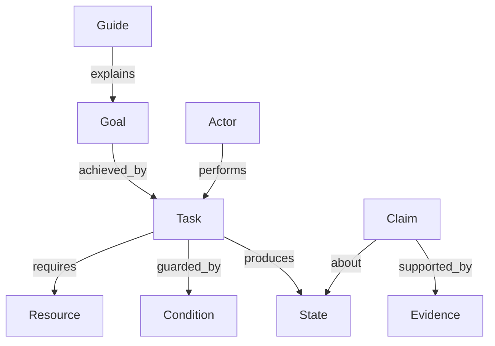

# 攻略本の作成オントロジー

住居手続きの例 (#29) と独立した設計。ゲーム攻略、行政手続き、ソフトウェア運用を同じ抽象語彙で記述する。個別の条件は利用側が管理する。

## 概念と関係

| 概念 | 意味 |
| --- | --- |
| Goal | 達成したい状態 |
| Actor | 行動主体 |
| Task | 実行可能な行動 |
| State | 観測された状態 |
| Condition | 行動の前提・分岐条件 |
| Resource | 必要な物・情報 |
| Evidence | 状態判断を裏付ける証跡 |
| Claim | 証跡から区別して記録する判断 |
| Guide | 読者向けの生成物 |

## 生成規則（初版設計）

- 条件が真と確認できた場合のみ対応する行動を提示する。偽なら除外し、不明なら確認質問を提示する。
- 前提が未完了なら後続を実行可能と扱わない。循環は診断する。
- 実行済み、相手の受領、目的達成は別の状態とする。
- 証跡の欠落は偽と同義ではない。観測・判断・推奨を分離する。
- 同一の入力から一枚図、持ち物、次の行動、質問、完了条件、Markdownを生成する。
- 公開用事例は合成データを優先し、個人情報・原本・固有の組合せによる再識別リスクを別途確認する。

## 分担案

ONTO: 共通語彙・関係・依存検査。TaxOntOy: 領域別分類。TopOntoLogy: 上位概念と構造。OnTautoLogy: 条件判定・未知・反例。markdown: 出力変換。可視化と公開は既存利用側へ委ねる。既存APIの重複実装は避ける。

## 受入条件

1. 合成したゲーム攻略と手続きの2領域で同じ語彙を使用する。
2. 条件の真・偽・不明、前提未完了、証跡欠落、循環をテストする。
3. 生成物とグラフの対応を検証し、未知の条件を確定しない。
4. Python標準ライブラリで動く最小構成を優先する。

この文書は設計案であり、生成規則の実装・実測はまだ行っていない。
