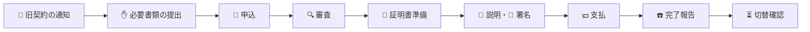

# 🏠 契約・申請の攻略本（匿名化した手続き事例）

これは一般的な**教育用の例**です。法律上の効力や必要書類は、契約本文、担当者の案内、自治体・事業者の条件で確認してください。元の会話・写真・住所・氏名・店舗・金額・固有日付は収録していません。

## まず一枚で見る

このケースでは、**申込はオンラインで済み、当初想定した申込目的の来店は不要**になりました。審査通過後の説明・署名・振込・報告は実施済み。最終切替の実施結果は証跡未確認です。「実行済み」と「相手に受領された」と「切替完了」は区別します。

## 絵文字で役割を見分ける

| 書類・行為 | まず考えること |
| --- | --- |
| 🙋 申込 | 希望を伝える。成立した契約と混同しない |
| 🤝 契約 | 双方の権利・義務は何か |
| 👌 同意 | どの事項に同意するか |
| ✋ 確約 | 誰が何を約束するか |
| 📝 覚書 | どの取り決めを確認・変更するか |
| 📢 通知 | 何を誰にいつ知らせるか |
| 🏛️ 申請 | 誰にどの判断・処理を求めるか |
| 📄 証明書 | どこが発行し、いつ提出するか |
| 💴 支払 | 金額・期限・入金先・受領確認 |

**タイトルだけでは法的効果は確定しません。**

## 「次に何をする？」の7問

1. 👥 誰と誰の手続き？
2. 🙋 自分は何をする・約束する？
3. 🏢 相手は何をする？
4. 💴 金額と支払期限は？
5. 📅 いつまでに何を終える？
6. 🚪 変更・中止するときの条件は？
7. ✍️ 署名・送信したら何が変わる？

## 持ち物は条件付き

この例の重要事項説明時は「住民票の写し」と「印鑑」が案内された。本人確認にはカード型の身分証明書を使うことがあるが、**身分証明書として持つことと、住民票に個人番号を記載することは別**。必要な証明書の範囲・記載事項・発行条件は提出先に確認する。住民票の写しは自治体発行の証明であり、自宅で複写した紙ではない。

## 状態と証跡

| 作業 | 状態 | 次の条件 |
| --- | --- | --- |
| 旧契約の通知 | 実施済みとの連絡 | 会社側の確認 |
| 申込 | 完了 | 審査結果待ち |
| 審査 | 通過の連絡 | 説明の日程 |
| 説明・署名 | 実施済み | 先方の処理 |
| 支払 | 振込操作済み | 入金反映確認 |
| 完了報告 | 連絡済み | 会社内の確認 |
| 契約切替 | **未検証** | 最終確認の証跡 |

**想定と観測を混ぜない**ことが攻略の中心です。困ったら「いま誰のボールか」「次に動く条件は何か」を確認します。

## 実装用データ

[匿名化した知識グラフ](../examples/procedure-guide/housing-contract.json)から `python -S examples/procedure-guide/build_guide.py examples/procedure-guide/housing-contract.json` でMarkdownを生成できます。語彙と関係を `ontology.violations` で検証し、`knowledgegraph.topological_order` で作業順を調べます。個人情報の公開を防ぐ保証はこの検証とは別です。公開前の人手による確認を省略しないでください。
